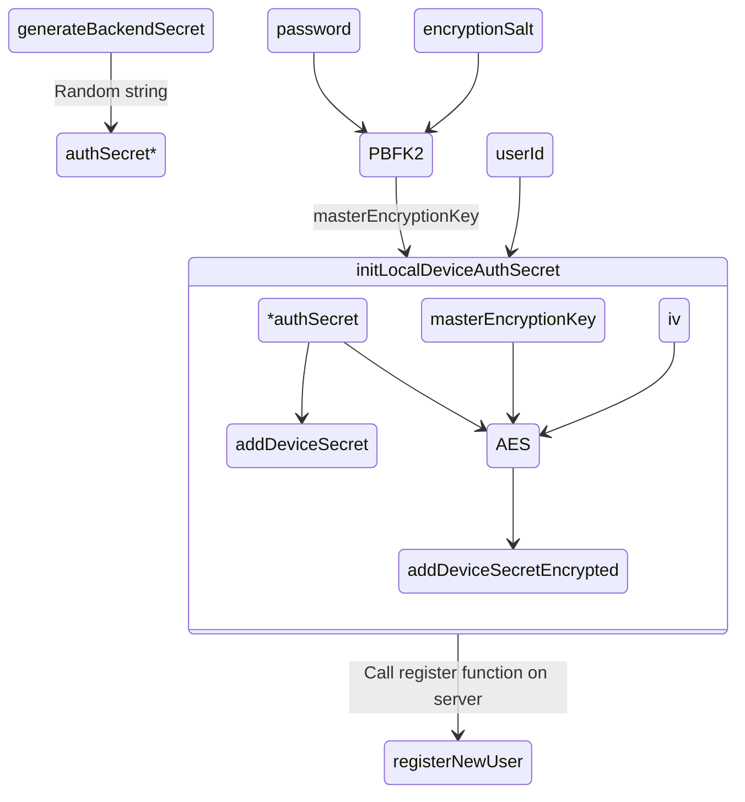

# Authentication

This document (in progress) is a short description of authentication process in authier

# Client

#### Register

1. Get password from user
2. generate encryption salt
3. PBFK2 = password + encryption salt = masterEncryptionKey
4. AES = `authSecret` + `masterEncryptionKey` + `userId` = addDeviceSecretEncrypted (+ addDeviceSecret)

- authSecret = random string
- we use AES cypher to get `addDeviceSecretEncrypted` from materEncryptionKey, userId and authSecret

5. Call `registerNewUser` mutation
6. If accessToken is in the responce we create state

#### Login

1. Get password from user
2. Request a device challenge. A new device stays pending without the account salt or encrypted enrollment secret.
3. Complete the account's configured approvals: email, another Authier device, either method, or both methods. The Chrome extension, Android app and web vault show the progress and require an explicit choice of policy when the account is unconfigured.
4. Use PBDFK2 for password encryption (masterEncryptionKey)
5. Try to decrypt `addDeviceSecretEncrypted` (from decryptionChallange) with masterEncryptionKey and parsed `userId`
   (If is decrypted deviceSecret same as the one from decryptionChallange, we know that the master password is correct)
6. Generate new deviceSecret and encrypt it with masterEncryptionKey
7. Call `addNewDevice` mutation on backend

# Server mutations

### registerNewUser

1. create user with device in DB
2. check if user with such email or device exists
3. get the current user device and set it on master
4. returns signed accessToken with user data

### deviceDecryptionChallenge

1. Get user by email (if exists)
2. Check if is user blocked
3. Check decryption challenge count
4. Get current device with challenge
5. Reject device IDs owned by another account. Unauthenticated requests never auto-approve the master device or reuse previously completed challenges, and never receive `addDeviceSecretEncrypted` or `encryptionSalt` before approval. Remembered/locked enrolled devices resume sessions via `resumeDevice` / `resumeDeviceSession` by proving possession of their current 256-bit `authSecret`.
6. Reject cancelled or blocked challenges.
7. Create a pending challenge and send the configured email and/or device notifications. An unconfigured account requires email approval until its owner saves a policy.
8. Return `addDeviceSecretEncrypted` and `encryptionSalt` only after the required approvals for an unverified challenge. With both approvals required, the first approval remains pending. Master-password verification is still required to finish login.

## Approval methods

`EMAIL` requires an email confirmation. `OTHER_DEVICE` requires approval from an already signed-in Authier device and is the recommended choice. `EMAIL_OR_OTHER_DEVICE` allows either method; `EMAIL_AND_OTHER_DEVICE` requires both. `MASTER_DEVICE` permits approval only from the current active master device and sends the approval push only to that device. It has no email or other-device fallback. Transferring the master role clears pending grants so the new master must approve them. Email is the most convenient and least secure standalone option, since access to the mailbox allows approval. Policy changes remain restricted to the master device after the initial choice.

Email includes approval and rejection links containing a random 256-bit token in the URL fragment, which is not transmitted in HTTP request URLs. Only its SHA-256 hash is stored. The confirmation page reviews the request through a read-only POST and requires an explicit button click to approve or reject, so GET requests from email scanners cannot decide a login. Rejection cancels the request, clears partial approvals and blocks that request's IP, matching rejection from an Authier device. Tokens expire after 15 minutes and are consumed once by either decision. Login polling reuses a live token rather than sending another email. Rejection and changes to policy, email or master password invalidate pending approval material.

## Rollout

Apply migration `20261111161247_condemned_zombie` through the normal backend deployment command (`pnpm wrdeploy` from `backend`) before deploying the new backend. The migration removes `ALLOW`, maps `REQUIRE_ANY_DEVICE_APPROVAL` to `OTHER_DEVICE` and preserves `REQUIRE_MASTER_DEVICE_APPROVAL` as `MASTER_DEVICE`, and prompts formerly unprotected accounts to choose a new policy. It revokes legacy automatic grants for devices that were never enrolled. Existing enrolled devices and deliberate recovery approvals remain available. The generated follow-up migration `20261111165107_daily_excalibur` also adds `MASTER_DEVICE` to development databases that applied the earlier four-policy schema; such databases cannot reconstruct the old master-only preference after it was converted, so it must be selected again there.

Release the updated Chrome extension, Android app and web vault together with the API contract change. Old clients cannot save the removed policy values. Email approval requires `MJ_APIKEY_PUBLIC`, `MJ_APIKEY_PRIVATE`, a valid configured `BACKEND_URL`, and `DISABLE_EMAIL_SENDING=false`; delivery failures never grant approval. Tests capture synthetic email and use PGlite, without contacting a production database or sending real email.

## addNewDevice

1. Get user by userId
2. Check if user exists and if we got right addDeviceSecet (masterPassword validation)
3. Update user with new `addDeviceSecret` and `addDeviceSecretEncrypted`
4. Mark device's decryption challenge as masterPasswordVerified
5. Check if is device registered for another user
6. Create new device in DB
