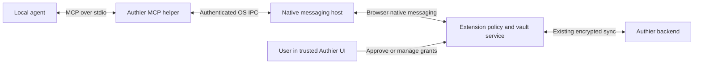

**Authier API keys and agent access — research and proposed MVP**

Research date: 27 October 2026. Status: **proposal awaiting approval; no feature implementation authorized yet**.

The repository review started at `4a8afe9c` and checked the relevant findings against `origin/main` at `2a32904b`. This document is the only proposed change on this planning branch.

**Recommendation**

Build API keys as a first-class encrypted vault item, capture newly displayed keys in the browser, and provide a local MCP server through which an explicitly paired agent can request an API key or a saved username/password. Let the user choose **Ask every time**, **Always allow while unlocked**, or **Never** for each agent registration, selected item, and operation.

Support returning the actual secret in the MVP, as requested. Make that a deliberate permission: once returned through MCP, it can enter the model context, transcripts, and the client's logs. Approval controls release; it does not control subsequent use or make a copied key expire. Build the permissions model so later process injection, browser filling, and HTTP brokering can have separate permissions.

The product hypothesis is that an individual developer wants one short workflow: **generate → capture → organize → grant access → let an agent request the right credential**. This is an execution and usability opportunity in an already competitive market. It is not a novel category.

**What competing solutions actually do**

These are documented capabilities, not results of a penetration test. I inspected official product documentation and selected public repositories; I did not install competitors or give them real credentials. Availability and platform support vary, including between different integrations from the same vendor.

| Solution                     | Observed approach                                                                                                                                                                                                                                                                                                                                                                                                                                                                                | Implication for Authier                                                                                                                                                                    |
| ---------------------------- | ------------------------------------------------------------------------------------------------------------------------------------------------------------------------------------------------------------------------------------------------------------------------------------------------------------------------------------------------------------------------------------------------------------------------------------------------------------------------------------------------ | ------------------------------------------------------------------------------------------------------------------------------------------------------------------------------------------ |
| 1Password: capture and vault | Has an API Credential item category. Browser release notes describe save notifications for GitHub and DigitalOcean tokens and a setting for saving shell-plugin credentials. [Categories](https://support.1password.com/item-categories/), [browser releases](https://releases.1password.com/b5x/stable/).                                                                                                                                                                                       | Capture at creation already exists. Reliability, supported sites, and a clear review flow matter more than a claim of invention.                                                           |
| 1Password: coding agents     | Its Environments MCP manages environments and variable names and prepares local `.env` destinations without returning stored values through MCP. Desktop authentication governs access. The official Kiro integration documents individual tools and limitations. [Codex workflow](https://1password.com/blog/1password-trusted-access-layer-for-openai-codex), [integration source](https://github.com/1Password/1password-kiro-plugin/blob/4553c5e7848357c7b07b9c334d139a7b6e7ccc1d/POWER.md). | Returning values and arranging runtime use are different APIs. A mounted file or injected environment still needs a threat model for code that can read it.                                |
| 1Password: browser agents    | 1Password for Agents describes task-specific requests, approval on the user's device, and direct filling of passwords or one-time codes for supported integrations. The page distinguishes available integrations from upcoming ones. [Product documentation](https://1password.com/personal-ai-agent-integrations).                                                                                                                                                                             | Generic MCP support alone cannot reproduce a browser integration that hides credentials from the agent. Do not promise universal credential-free browser login.                            |
| Bitwarden                    | Its official local MCP server exposes vault reads and writes through the CLI and explicitly warns that credentials can appear in AI responses. Its separate Secrets Manager uses machine accounts with project-scoped access and access logs. [MCP repository](https://github.com/bitwarden/mcp-server), [machine accounts](https://bitwarden.com/help/machine-accounts/).                                                                                                                       | A generic vault wrapper is available already. Authier should start with a smaller retrieval surface and item-specific grants rather than expose account administration and vault mutation. |
| Keeper Secrets Manager       | Its MCP README describes metadata listing, masked reads, confirmation before unmasking or mutation, and an auto-approve option. It also documents a confirmation-execution tool. [Official repository](https://github.com/Keeper-Security/keeper-mcp-golang-docker/tree/eaf0f17b7c2ac9f96fb95b75ec5eb4dad294cf0c).                                                                                                                                                                               | “Confirmation” in documentation is not proof of independent human authorization. Authier must not accept a model-supplied `approved: true` or expose an approval tool.                     |
| Doppler                      | Its experimental MCP supports reading secret values and managing projects/configs. Authentication can use browser login or an existing token, cached in the system keyring; token permissions restrict API operations. [Documentation](https://docs.doppler.com/docs/mcp).                                                                                                                                                                                                                       | Good precedent for setup and scoped automation, with a project/config workflow rather than browser capture and ordinary website logins.                                                    |
| Infisical Agent Vault        | Its open-source HTTP proxy substitutes real credentials into outbound requests, supports egress rules, and can use external secret stores. The README recommends a separate machine for the isolation guarantee and distinguishes the standalone project from the commercial product. [Official repository](https://github.com/Infisical/agent-vault).                                                                                                                                           | Useful direction for stronger isolation later. Building a proxy with TLS interception, policy enforcement, and deployment isolation would substantially expand this MVP.                   |
| Varlock                      | Resolves secret references at runtime, supports agent-oriented redacted output, and offers a credential proxy. Its documentation explicitly distinguishes accidental-output redaction from protection against malicious code with access to plaintext. [AI tools](https://varlock.dev/guides/ai-tools/), [proxy](https://varlock.dev/guides/proxy/), [limitations](https://varlock.dev/guides/secrets/).                                                                                         | Consider a future Authier provider/plugin instead of recreating every environment-file integration. Redaction and process environment injection must not be advertised as a sandbox.       |
| Palladin                     | A particularly close, explicitly pre-production competitor: local CLI/MCP with grant-controlled `get`, `exec`, and `inject`, expiry, usage limits, and audit lifecycle. Its README acknowledges the disclosure boundary of `get`. [Official repository](https://github.com/Palladin-io/palladin-agent/tree/de8b9a4555a54baac45c9e5beca4f403b7ad676f).                                                                                                                                            | Validate the whole user journey against this approach. Granular approvals and three delivery methods are not unique differentiators.                                                       |
| Key Vault browser extension  | Its experimental Mozilla listing advertises recognition of copied API keys, a pending-key badge, source-domain metadata, and local encrypted storage. This is a publisher claim; the extension was not exercised. [Listing](https://addons.mozilla.org/en-US/firefox/addon/key-vault/).                                                                                                                                                                                                          | There are small products focused directly on capture. Avoid assuming that every site's Copy button can be observed through an ordinary copy event.                                         |

1Password's documentation is changing quickly. For example, the [July 2026 Cursor announcement](https://1password.com/blog/the-1password-environments-mcp-server-is-now-on-cursor-marketplace) and the Kiro integration do not describe identical platform coverage. I would verify the particular integration before making platform comparisons in marketing. Historical claims that 1Password has no MCP server are no longer a sound competitive premise.

**Evidence of demand, and its limits**

| Discussion                                                                                                                                           | What the original poster or participant actually wanted                                                                                                                                   | Design implication                                                                                                                                         |
| ---------------------------------------------------------------------------------------------------------------------------------------------------- | ----------------------------------------------------------------------------------------------------------------------------------------------------------------------------------------- | ---------------------------------------------------------------------------------------------------------------------------------------------------------- |
| [Ask HN: managing secrets from env files](https://news.ycombinator.com/item?id=41629168), September 2024                                             | The poster described accidentally exposed API keys discovered through a billing alert and asked what secrets manager to use.                                                              | Prevent casual plaintext storage and make the right workflow easier than a loose file.                                                                     |
| [HN: Claude Code keys in KeePassXC](https://news.ycombinator.com/item?id=47517931)                                                                   | The author described fetching keys through a password-manager CLI at invocation time instead of keeping them in plaintext configuration.                                                  | Runtime access from an existing vault is useful even without a new enterprise secrets platform.                                                            |
| [Reddit: safe credential sharing with AI agents](https://www.reddit.com/r/AI_Agents/comments/1rlb4c8/safe_ways_to_share_credentials_with_ai_agents/) | A user wanted an agent to log into multiple websites to collect tax documents and asked for a safer alternative to exported credentials.                                                  | Ordinary website logins belong in the problem definition alongside API keys. Replies include vendor promotion; the original question is the demand signal. |
| [Reddit: self-hosted secrets proxy for agents](https://www.reddit.com/r/selfhosted/comments/1s11du0/self_hosting_secrets_proxy_for_agents/)          | The poster explicitly wanted agents to use third-party services without holding the keys, with scoped access and auditability.                                                            | Some users will reject raw-secret retrieval. Keep a clear path to a brokered-use mode.                                                                     |
| [Reddit: storing API keys and secrets](https://www.reddit.com/r/selfhosted/comments/1wyxn2q/storing_api_keys_secrets/)                               | The poster was already using a password vault and wondered whether machine secrets needed a separate system. Replies show a mix of vaults, encrypted files, and dedicated infrastructure. | A simple personal workflow is worth testing; a second service is not automatically an improvement.                                                         |
| [Bitwarden: hidden custom fields by default](https://community.bitwarden.com/t/make-custom-field-hidden-by-default/12976)                            | A user storing API keys in custom fields wanted sensitive values hidden by default.                                                                                                       | Use a dedicated masked key field, not an ordinary text field or a fake login.                                                                              |

This is qualitative evidence of the problem, not proof of market size, willingness to pay, or demand for Authier specifically. New-product announcements are competitive evidence, not independent customer validation. The research does not establish that most users currently store keys in text files.

Proposed positioning to validate: **“Save the key when you generate it. Choose which agents can use it.”** Lead with capture, correct account/environment selection, and understandable permissions. Avoid “agents can never leak your secrets” for the proposed retrieval MVP.

**MVP scope to approve**

| Included                                                                                                                   | Deferred                                                                                                     |
| -------------------------------------------------------------------------------------------------------------------------- | ------------------------------------------------------------------------------------------------------------ |
| A dedicated `API_KEY` item in the existing encrypted vault                                                                 | Credential bundles such as AWS key ID + secret + session token                                               |
| Create, view masked, reveal, copy, edit, delete, and search API keys in the extension and web vault                        | Full Android API-key UI, mobile capture, and phone-based agent approvals                                     |
| Manual paste on any site; explicit “Save selected text as API key”                                                         | Universal automatic detection on every website                                                               |
| Assisted capture for OpenAI, Anthropic, GitHub, Cloudflare, and Stripe key-generation pages, subject to fixture validation | Intercepting all network responses or observing the global clipboard continuously                            |
| Encrypted local capture drafts and a durable retry queue for confirmed saves                                               | A new cryptographic write-only inbox that can capture while the vault is locked                              |
| A local MCP helper for local Claude Code and Codex, initially verified on Linux and macOS                                  | Public/remote MCP hosting, cloud agents, unattended CI, and Windows helper distribution in the first beta    |
| Browser-agent retrieval for a separate automation browser/profile                                                          | Enforcing agent permissions over an existing human browser profile's ordinary autofill or signed-in sessions |
| Scoped discovery and explicit retrieval of API keys and existing username/password logins                                  | MCP vault creation/edit/delete, account administration, bulk export, and policy mutation                     |
| Independent Authier approval, scoped automatic access, revocation, and a local activity history                            | Generic browser filling, arbitrary command execution, HTTP proxying, automatic provider-side rotation        |
| Compatibility changes so Android and older supported clients do not corrupt or lose vault items                            | Returning TOTP seeds or passkey private keys; MFA automation is a separate follow-up                         |

“Always allow” applies while the vault is unlocked and the request is within a valid grant. It does not bypass the vault lock or supply credentials when the browser/helper is unavailable. Password-based login retrieval satisfies the initial browser-agent use case; MFA may still require the user.

**The capture experience**

1. The user enables API-key capture. Start with a fixed list of supported providers, with a per-site off switch.
2. On a supported generation/reveal screen, a local adapter recognizes a full value and submits a candidate to the background process. The background derives the actual origin and frame identity from browser sender metadata, validates size and format, and ignores masked/truncated candidates.
3. While unlocked, immediately encrypt the candidate into a local pending-review draft. Show a small “API key captured — review to save” notice and extension badge. Persisting this draft lets the user navigate away without losing the candidate.
4. In Authier's own UI, the user confirms the label, account/project, environment, and optional environment-variable name. The value is masked. Saving creates a durable encrypted item and an idempotent sync operation. Unreviewed drafts are not available to agents.
5. Show **Saved on this device — sync pending** until the backend confirms the write, then **Synced**. A network failure or quota error must not erase the local encrypted copy or report cloud success. Deduplicate retries by stable item/operation IDs.
6. An identical key is offered as an existing item. A different key for the same service is a new item or an explicit replacement, never an automatic overwrite based only on domain/name.

Manual paste and selection capture remain available for unsupported providers. A Copy button may use a clipboard API without leaving the full key in the DOM; use an explicit user-initiated paste/read flow in that case. Browser clipboard behavior differs and is unavailable directly in a service worker. [Browser API details](https://developer.mozilla.org/en-US/docs/Web/API/Clipboard_API).

If Authier is locked, show **Unlock to save this key before leaving this page**. Do not claim that capture succeeded or persist a plaintext candidate. After unlock, re-read the still-open generation screen or use manual paste. The MVP cannot recover a key that the provider only returns once after that screen is gone. Supporting durable capture while locked requires separately designed and reviewed encryption and is deferred explicitly.

Capture must remain local: do not send keys, surrounding key-page HTML, screenshots, or copied text to the existing cloud form classifier, analytics, or error-reporting services. Restrict adapters to known key-management origins/routes and bounded DOM regions; do not scan arbitrary page text for high-entropy strings. Start with top-level pages; use manual capture for unsupported frames. Provider text is data, never instructions or proof of a key's permissions.

Pending drafts have a visible expiry and bounded storage, with a proposed 24-hour retention period; dismissal deletes them. Confirmed unsynced items do not expire. Account switching must isolate drafts and queued writes. Password changes must re-encrypt queued records or block until they are safely reconciled, and logout must disclose any unsynced records before removing local storage.

**Vault model and matching**

Use the existing `EncryptedSecret` envelope with a new `API_KEY` kind. Keep all semantic metadata inside the encrypted payload; the backend still sees the existing envelope metadata, including item kind, IDs, versions, and timestamps.

Proposed payload fields:

| Field                               | Purpose                                                                           |
| ----------------------------------- | --------------------------------------------------------------------------------- |
| `schemaVersion`, `label`, `value`   | Versioned schema, human name, and the complete key string                         |
| `provider`, `managementOrigin`      | Confirmed provider and the generation site's origin; omit query strings/fragments |
| `serviceOrigins`                    | Optional documented API destinations, distinct from the management website        |
| `account`, `project`, `environment` | Optional disambiguation, editable by the user                                     |
| `envVarName`                        | Optional name such as `STRIPE_SECRET_KEY`; not a unique credential identifier     |
| `expiresAt`, `status`               | Optional user-supplied expiry and active/revoked state                            |

Derive masked previews locally. Do not send fingerprints, prefixes, last characters, account names, or key values to the backend as a search index. Keep API-key values out of ordinary search text and out of autofill's content-script initialization payload.

Resolve by explicit item ID or an exact combination of provider/account/project/environment within the client's permitted items. Multiple matches produce an ambiguity response; do not silently pick the newest, most recently used, or production key. Never fall back from test/staging to production. A provider prefix is a hint, not proof of ownership, validity, scope, or environment.

Expiry/revocation metadata prevents automatic release, but does not revoke the actual credential at its issuer. Updating a key changes its record version and invalidates pending approvals and automatic grants for that version. Metadata-only changes can initially use the same conservative invalidation rule. API keys should count toward the current shared credential quota; backend quota accounting already groups non-TOTP items together, but labels and boundary tests need updating.

**Local architecture**



The extension remains the authority for decryption, matching, permissions, and approval. The helper receives only the selected secret after authorization, never the master password, vault decryption key, full vault snapshot, or reusable Authier backend session. Do not enroll the MCP client as a normal full-vault device merely to reuse device login.

Create a small TypeScript/Bun workspace for the installed helper, with separate MCP and native-host entry modes. Native messaging and MCP stdio have different framing and process lifecycles; the two modes must not be conflated. The browser launches the native host, and MCP processes connect through a per-user Unix socket. Keep the IPC adapter portable so Windows named pipes can follow without changing policy semantics. Use the official MCP SDK and pin tested versions.

Native messaging requires an installed host manifest and exact extension allowlists. Chromium and Firefox use different registration details. Authier currently has neither a native host nor the native-messaging permission. Add an opt-in permission and installation/diagnostic/uninstall flow. Test stable extension IDs, multiple browser profiles, reconnects, suspension, browser restart, and concurrent clients. [Chromium documentation](https://developer.chrome.com/docs/extensions/develop/concepts/native-messaging), [Firefox documentation](https://developer.mozilla.org/en-US/docs/Mozilla/Add-ons/WebExtensions/Native_messaging).

Use a pinned installed executable with release checksums and an absolute path in MCP configuration. Do not resolve helper code from the agent's working directory or run a moving package version on each request. Packaging and update verification are part of the native-helper work.

Prefer this over exposing a localhost HTTP/WebSocket endpoint to webpages or turning the cloud backend into a plaintext vault service. The MCP specification supports stdio for local subprocesses; implementation must negotiate the versions supported by actual clients rather than assume all clients use the newest revision. [Transport specification](https://modelcontextprotocol.io/specification/latest/basic/transports).

**Pairing, approval, and security boundaries**

- Pair one local client registration to one Authier account and browser profile through a short-lived, single-use ceremony in the extension. Verify possession of its pairing credential on every connection. Store the credential in the OS credential store, outside repositories and MCP configuration files; configuration contains only a non-secret registration identifier. Verify extension identity and bind requests to the paired profile.
- Display the verified registration identity separately from any client-reported name. MCP client names, requested project paths, and stated purposes are not authenticated identity. Grants authorize that registration; they do not prove which model, conversation, or human task is executing.
- Pairing starts with no visible items. The user selects items and permitted operations. New items do not silently join existing grants. Default selected items to **Ask every time**; **Always allow while unlocked** is an explicit user choice. **Never** overrides grants.
- Scope each rule to account, local device/profile, client registration, item ID and version, and operation. Keep grant configuration local for the first beta; another device must pair separately. Do not sync an “always allow” permission silently to another machine.
- Approvals happen in trusted extension UI, never inside a webpage or through an MCP tool. Bind approval to request ID, registration, exact item/version/fields, session generation, and expiry. Show the account/environment and that a raw value will be returned. Treat the agent's reason as untrusted text.
- For **Ask every time**, require user verification using Authier's existing master-password verification flow, including when already unlocked. Pairing and permission expansion also require verification. Password entry stays entirely inside trusted Authier UI. An extension popup alone is not proof of a human if an agent can automate browser chrome; OS verification or a separate trusted device is a future usability improvement.
- **Allow once** permits one response, not a time-limited copy of the upstream credential. **Always allow** permits future matching requests while unlocked until revoked or invalidated. Do not introduce an implicit session-wide permission just because one request was approved.
- Lock, logout, password rotation, account change, item replacement/deletion, revocation, cancellation, expiry, or bridge restart invalidate affected pending requests. Recheck identity, current policy, vault session, and item version immediately before release. Never deliver a late response from a previous session.
- Before credential release, validate the device's backend session and synchronize the vault. In this MVP, loss of connectivity prevents agent release and yields an availability error; local encrypted capture and human vault reading can still work. This avoids indefinitely serving deleted/replaced credentials or a remotely revoked device from an offline cache. Local grant revocation applies immediately; remote changes take effect when observed through authenticated sync.
- Provide an immediate **Disable agent access** control and individual client revocation. Invalidate outstanding requests and remove pairing credentials on unpairing. This does not claw back secrets already returned; affected provider keys/passwords must be rotated when necessary.
- Keep a bounded, encrypted local activity history: request ID, registration, item ID when permitted, operation, decision, time, and policy/grant reference. Record denial, automatic release, approval, and revocation without key values, full request bodies, arbitrary agent reasons, or raw URLs. This is useful history, not a tamper-proof enterprise audit system. Fail closed if a release cannot be recorded locally.

While locked, keep at most a bounded in-memory queue of status-only history events and encrypt them after unlock; a restart can lose those events. Do not add a plaintext audit file to work around the locked vault. Distinguish authorization/release attempts from downstream use: the history cannot prove what an agent subsequently did at the provider.

For browser automation in the MVP, use a separate automation profile without access to ordinary Authier autofill; the paired vault/approval extension stays in the user's profile. An agent with control of the user's already-unlocked browser can otherwise obtain filled credentials or reuse signed-in sessions outside MCP. These grants govern MCP requests, not all access the agent already has. Supporting that shared-profile case requires an agent-aware browser integration that gates existing autofill routes and cannot be disabled by the agent; it is separate follow-up work.

This design limits access through Authier's interface and reduces accidental exposure. It cannot protect against a malicious process with unrestricted access to the same OS account, an already compromised extension, or arbitrary code after a raw secret has been delivered. OS credential storage and local IPC permissions are useful controls, not complete isolation from a same-user shell agent. A stronger guarantee requires an isolated broker/runtime and its own review.

Prompt injection is relevant even when the MCP server itself is trusted: researchers demonstrated an agent using trusted GitHub tools to leak private data after reading an attacker-controlled issue. [Original research](https://invariantlabs.ai/blog/mcp-github-vulnerability). Use MCP's [security guidance](https://modelcontextprotocol.io/specification/latest/basic/security_best_practices) for protocol threats, while enforcing item permissions in Authier rather than relying on tool descriptions or client confirmation settings.

**Proposed MCP contract**

These tool names are a reviewable proposal, not an implementation. Use shared Zod schemas and discriminated result types.

| Tool                 | Contract                                                                                                                                                                                |
| -------------------- | --------------------------------------------------------------------------------------------------------------------------------------------------------------------------------------- |
| `authier_status`     | Report pairing, bridge, lock, and sync availability without secret data.                                                                                                                |
| `find_credentials`   | Bounded, filtered metadata discovery inside the explicitly permitted item set. Return ID, kind, label, and approved account/environment metadata; omit values, notes, and key previews. |
| `get_api_key`        | Resolve one API key and enforce its retrieval rule. Return an authorized value, pending approval, ambiguity, absence, or a typed failure.                                               |
| `get_login`          | Resolve one username/password item for an exact canonical origin and optional account. Use the same permission/approval engine with a separate operation grant.                         |
| `get_request_result` | Poll a pending request owned by this registration; release an approved result once after final checks.                                                                                  |
| `cancel_request`     | Cancel this registration's pending request and invalidate its approval.                                                                                                                 |

Do not expose `approve_request`, `unlock(password)`, `set_policy`, arbitrary shell execution, or bulk credential export. Keep stdout exclusively for protocol messages and scrub diagnostic/error paths. MCP tool annotations describe behavior; they are not authorization.

Example missing result:

```json
{ "status": "not_found", "scope": "permitted_items" }
```

`not_found` means no match in the client's permitted, successfully synchronized view. Out-of-scope records are indistinguishable from absent records. Agents must not interpret this as proof that the user's entire vault lacks the key.

Other explicit outcomes include `ambiguous`, `pending_approval`, `denied`, `expired`, `consumed`, `vault_locked`, `bridge_unavailable`, `vault_unavailable`, `reauthentication_required`, `credential_inactive`, and `rate_limited`. Only successful disclosure results contain a secret. Protocol or validation failures are MCP errors, and expected business states are typed tool results; an upstream outage must never become `not_found`.

Return pending approval promptly rather than hold a tool call indefinitely. Proposed request expiry is two minutes. Duplicate polls do not reopen prompts; throttle polling and coalesce duplicate requests without broadening scope. Store only request metadata and approval state, not a cached plaintext response. Re-resolve the exact item version at delivery, atomically consume the grant, and discard late or repeated delivery attempts. A lost response may require a new approval; do not introduce an unbounded replay cache of secrets.

The origin supplied to `get_login` constrains selection and is shown to the user. It is not proof of the agent's current browser tab and cannot restrict where a password is used after disclosure. A future `fill_login` must independently bind to an actual tab/frame/document origin, recheck navigation, and return only an outcome. Filling an ordinary DOM field is not automatically invisible to browser automation with DOM access.

**Repository work required**

| Existing area                                                                                                                                                          | Finding and planned work                                                                                                                                                                                                                                                                    |
| ---------------------------------------------------------------------------------------------------------------------------------------------------------------------- | ------------------------------------------------------------------------------------------------------------------------------------------------------------------------------------------------------------------------------------------------------------------------------------------- |
| [Database schema](../backend/drizzle/schema.ts), [GraphQL enum](../backend/models/types/EncryptedSecretType.ts), [shared API schemas](../shared/orpc/schemas.ts)       | All enumerate TOTP, login, and passkey kinds. Add the API-key kind, generated contracts, and compatibility handling deliberately. Generate migrations with the existing command.                                                                                                            |
| [Shared crypto](../shared/cryptoUtils.ts)                                                                                                                              | Reuse the existing AES-GCM envelope and client encryption. No new cloud decryption service or new vault-wide key exposed to the helper.                                                                                                                                                     |
| [Extension vault state](../web-extension/src/background/ExtensionDevice.ts)                                                                                            | Unknown kinds throw; several non-passkey branches assume login/TOTP. Add exhaustive type handling and positive allowlists. Current `addSecrets` performs the network mutation before local persistence, so capture needs durable encrypted storage and retries.                             |
| [Web vault decoding](../vault-web/src/lib/vaultSecrets.ts)                                                                                                             | Unhandled kinds fall through to TOTP. Add explicit API-key decoding and a safe unknown-item representation. Keep metadata/search projections separate from secret values.                                                                                                                   |
| [Content initialization](../web-extension/src/background/getContentScriptInitialState.ts), [runtime routing](../web-extension/src/background/chromeRuntimeListener.ts) | Keep API keys out of ordinary login autofill state. Introduce privileged agent routes with sender checks, swallow malformed agent messages before the generic tab relay, and remove credential/state logging on relevant paths. Do not reuse content-script messages as approval authority. |
| [Cloud form classification](../web-extension/src/background/classifyPasswordForm.ts)                                                                                   | This route sends form snapshots to the backend. API-key detection must not reuse it with key-bearing content. Add a regression test that capture cannot reach this route.                                                                                                                   |
| [Passkey approval](../web-extension/src/passkeys/backgroundPasskeys.ts)                                                                                                | Existing request binding, trusted UI, verification, and cancellation provide patterns to reuse. Extract shared mechanics only where needed; agent grants remain distinct from passkey and device enrollment rules.                                                                          |
| [Vault writes](../backend/vault/vaultWrites.ts), [API contract](../shared/orpc/contract.ts)                                                                            | Reuse transaction/version checks and the modern API's item IDs and idempotent operation IDs for queued writes. Avoid a second cloud vault API or wholesale GraphQL migration.                                                                                                               |
| [Password rotation](../web-extension/src/background/reencryptVaultSecrets.ts), [server rotation](../backend/models/UserMutation.ts)                                    | Rotation already checks full item coverage and versions. Preserve that protection, include API keys and pending encrypted drafts, and invalidate agent sessions. Never filter away unsupported items and then allow an incomplete rotation.                                                 |
| [Android API facade](../android-app/app/src/main/java/dev/authier/android/ApiFacade.kt), [models](../android-app/app/src/main/java/dev/authier/android/VaultModels.kt) | Native domain records keep kinds as strings, but generated transport models use closed enums. Test the whole decode path; retaining an unknown domain kind alone does not guarantee wire compatibility. Preserve unsupported ciphertext and prevent destructive edits.                      |
| [Usage events](../backend/drizzle/schema.ts)                                                                                                                           | Existing events require a secret ID and include plaintext URL metadata. They are not a ready-made store for denied requests or private agent history. Start with a separate encrypted local log rather than force incompatible events into this table.                                      |
| [UI previews](../web-extension/ui-preview/README.md)                                                                                                                   | Add production-component scenarios for capture review, API-key list/detail, sync failure, locked state, pairing, approval, and grant management. Capture fresh screenshots for implementation responses and PRs.                                                                            |

Compatibility needs a specific rollout contract. Add a negotiated supported-kind/capability mechanism for upgraded clients; legacy requests default to the legacy set. Cover bootstrap, incremental sync, GraphQL, pagination/cursors, deletion tombstones, and account recovery. Capability changes must reset/reconcile sync so newly supported records are not skipped forever. Unsupported items remain stored on the server. Keep full-vault rotation requirements so an old client cannot orphan hidden items. Show an upgrade-required response when a legacy client attempts a whole-vault operation it cannot safely complete. Merely deploying an enum migration and hoping every device updates is insufficient.

**Implementation sequence after approval**

| Stage                                       | Deliverable                                                                                                                                                                            | Exit criterion                                                                                                                                                                                                                                                                         |
| ------------------------------------------- | -------------------------------------------------------------------------------------------------------------------------------------------------------------------------------------- | -------------------------------------------------------------------------------------------------------------------------------------------------------------------------------------------------------------------------------------------------------------------------------------- |
| 0. Resolve feasibility and trust boundaries | Finalize the threat model, grant semantics, compatibility contract, and helper packaging. Build a disposable synthetic-data transport/approval proof only after approval.              | Linux Chromium and Firefox can pair a local MCP client, request, approve/deny, reconnect, and invalidate on lock. Confirm macOS installation/user-verification approach and actual Codex/Claude client support. Bring back a revised plan if the proposed boundary cannot be enforced. |
| 1. Vault storage and safe rollout           | API-key schema, migration, generated APIs, extension/web CRUD, compatibility updates, encrypted draft/outbox storage, rotation/backup handling.                                        | Mixed old/new clients retain existing items; a confirmed key survives restart and failed sync; no unsupported client can erase or incompletely rotate it. Manual save works end to end with synthetic data.                                                                            |
| 2. Browser capture                          | Five provider adapters, generic manual fallback, review UI, deduplication, source validation, site preference, clear locked/offline behavior.                                          | Fixture coverage for visible, masked, truncated, late-rendered, copy-only, duplicate, changed-key, and unsupported-page cases. No false “saved” success and no key sent to classification/telemetry.                                                                                   |
| 3. Agent access                             | Installed TypeScript/Bun helper, native messaging integration, pairing, selected-item discovery, API-key/login retrieval, approval queue, always-allow rules, revocation, activity UI. | Actual local Codex and Claude Code retrieve a selected synthetic key/login, report a missing item accurately, handle ambiguity, and cannot retrieve ungranted items or approve their own requests.                                                                                     |
| 4. Hardening and beta                       | Failure/race testing, installer/upgrade/uninstall checks, documentation, screenshots, synthetic demo, and security review.                                                             | Release gates below pass. Ship API-key capture and agent access behind separate opt-ins so either can be disabled without losing saved keys.                                                                                                                                           |

Implementation should be separate reviewable commits/PRs. Keep local work committed and pushed according to repository instructions. This planning change does not authorize implementation or production deployment.

**Release gates and acceptance tests**

1. **Capture reliability:** a generated full key is preserved locally before a successful-save indication, survives navigation/restart after encryption, and syncs once after transient failure. A locked vault and a quota failure have explicit outcomes. Never save masked placeholders as usable secrets.
2. **Correct selection:** personal/work and test/production records cannot be confused. Ambiguous queries return choices within scope. Expired or locally revoked items are not silently released. Inaccessible items cannot be enumerated.
3. **Permission enforcement:** an unpaired process, wrong profile/account, forged client name, malicious webpage, forged approval message, and out-of-scope item ID all fail. Every release is checked in the extension policy service. Agent-facing APIs cannot edit policies or perform human verification.
4. **Approval lifecycle:** allow once releases once; denial, cancellation, two-minute timeout, concurrent polls, duplicate requests, changed keys, restart, logout, password rotation, and late replies cannot cause a second or stale release. Always-allow remains limited to its registered item/version/operation and the unlocked state.
5. **Confidentiality:** planted synthetic canary values are absent from persistent plaintext storage, logs, errors, source URLs, telemetry, ordinary content initialization, and classification requests. Intentional raw MCP responses are the documented exception; use a disposable agent session to test it.
6. **Sync and compatibility:** mixed kinds, tombstones, cursor resets, retries, old clients, password changes, encrypted drafts, and recovery/export paths preserve every item. Tests requiring a database use in-memory PGlite with `setupTestDb()` in `beforeAll()` and cleanup in `afterAll()`.
7. **Validation:** root `pnpm lint`; relevant TypeScript checks and targeted unit/integration tests; generated GraphQL/OpenAPI/Kotlin checks; extension UI-preview checks and meaningful Playwright flows on Chromium/Firefox. No tests against production databases or real keys.
8. **Visual review:** checked-in preview scenarios use production components and synthetic secrets. Newly captured screenshots accompany each user-visible feature response and its PR, including error/locked/approval states where relevant.
9. **Deployment:** generate migrations via the backend's `pnpm db:generate`, then apply pending migrations before backend production deployment. Local backend deployment uses `pnpm wrdeploy`; Cloudflare production Builds keeps `pnpm run db:migrate && npx wrangler deploy` with build-time `DATABASE_URL`. Abort on migration failure. Keep feature exposure off until compatible clients and tests are in place; rollback disables capture/MCP without dropping encrypted items.
10. **Beta claim:** no public claim of isolating secrets from arbitrary agent code. Before a broad release, obtain a security review of pairing, IPC, approvals, and leakage paths. Use opt-in pilot feedback to measure successful captures, selection mistakes, approval burden, and setup failures without collecting secret values or browsing history.

**Follow-up roadmap, outside this approval**

Prioritize a way to use credentials without returning them if beta users require it. Candidate work includes `authier run` with runtime injection, a Varlock provider, and browser `fill_login`. Each needs an explicit security contract: arbitrary child code can read injected environment variables, output redaction can be bypassed, and DOM-capable agents may read filled fields. A proxy with enforced destinations/actions and an isolated credential boundary offers a stronger model, with substantially more work around redirects, DNS/SSRF, response leakage, TLS, and authorized-action abuse.

Other follow-ups: Windows helper packaging, Android API-key management and trusted-device approvals, a reviewed write-only inbox for locked capture, user-approved current TOTP codes, passkey browser workflows, credential bundles, and provider-specific expiry/rotation integrations. Agent creation/editing of vault items needs its own permission model rather than inheriting retrieval access.

**Approval requested**

Approve the scope above: desktop API-key storage and capture, local MCP retrieval for API keys and existing logins, default verified approval with scoped opt-in automatic access, Linux/macOS beta, and no raw-secret-isolation claim. This includes the compatibility and durable-save prerequisites. Implementation starts only after that approval; stronger brokered-use modes remain a separate decision.
